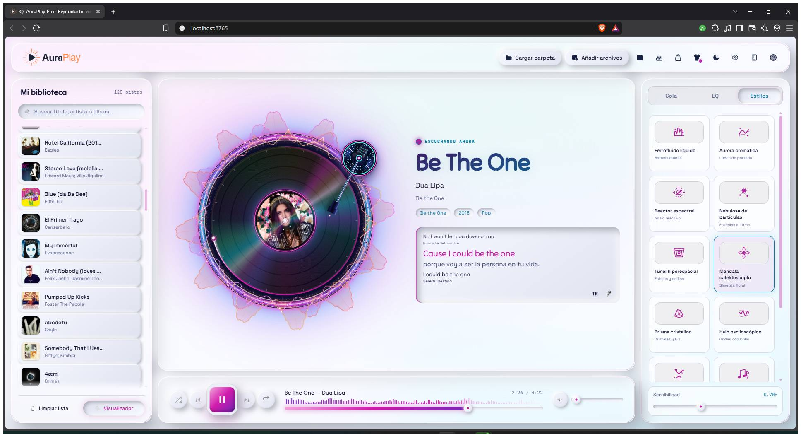

# AuraPlay Pro

> Reproductor de música web **local**, construido con HTML, CSS y JavaScript nativos. Combina ecualizador, visualizadores reactivos al audio, karaoke sincronizado, listas persistentes, personalización visual y un mando remoto opcional para el teléfono.

AuraPlay Pro se ejecuta directamente en un navegador moderno: no usa framework de frontend, no requiere base de datos y no necesita backend para la reproducción.



**Vista rápida**

| | |
| --- | --- |
| **Audio** | Archivos locales, ecualizador de 10 bandas, scratch granular |
| **Visual** | 12 visualizadores, 10 skins, 8 superficies, tema claro/oscuro |
| **Letras** | Karaoke LRC con 6 estilos y progreso palabra por palabra |
| **Biblioteca** | Cola reordenable, listas persistentes y exportación `.m3u` |
| **Control** | Atajos de teclado y mando remoto móvil por red local |
| **Privacidad** | La música nunca se sube a un servidor |

## Contenido

- [Características](#características)
- [Requisitos](#requisitos)
- [Inicio rápido](#inicio-rápido)
- [Demo musical](#demo-musical)
- [Uso de la aplicación](#uso-de-la-aplicación)
- [Mando remoto móvil](#mando-remoto-móvil)
- [Atajos de teclado](#atajos-de-teclado)
- [Build de producción](#build-de-producción)
- [Arquitectura](#arquitectura)
- [Personalización y extensión](#personalización-y-extensión)
- [Desarrollo y validación](#desarrollo-y-validación)
- [Limitaciones y privacidad](#limitaciones-y-privacidad)
- [Licencia](#licencia)

---

## Características

### Reproducción local

- Arrastrar y soltar archivos de audio y archivos `.lrc`.
- Selección múltiple de archivos y de carpetas (cuando el navegador lo permite).
- Formatos habituales del navegador: MP3, M4A, WAV, OGG, FLAC, AAC, OPUS y WMA, sujetos al soporte del navegador y del sistema.
- Controles de reproducción, pausa, pista anterior y siguiente.
- Búsqueda dentro de la pista mediante la barra de progreso, la forma de onda y el vinilo interactivo.
- Volumen, silencio, aleatorio y modos de repetición: desactivado, repetir lista y repetir una pista.
- Lectura de metadatos ID3 y carátulas mediante `jsmediatags`.
- Motor de scratch granular tipo Baby Scratch, con reproducción invertida desde un `AudioBuffer`.

### Visualizadores reactivos al audio

El selector integrado ofrece 12 visualizadores independientes:

| # | Visualizador | Descripción |
| --- | --- | --- |
| 1 | **Ferrofluido líquido** | Barras, gotas y ondas de choque. |
| 2 | **Aurora cromática** | Cintas de luz basadas en los colores de la portada. |
| 3 | **Reactor espectral** | Espectro LED segmentado y anillos HUD. |
| 4 | **Nebulosa de partículas** | Vórtices, constelaciones y explosiones al ritmo. |
| 5 | **Túnel hiperespacial** | Estelas con efecto de desplazamiento y aberración cromática. |
| 6 | **Mandala caleidoscopio** | Pétalos simétricos en varias capas. |
| 7 | **Prisma cristalino** | Cristales facetados y barridos de luz. |
| 8 | **Halo osciloscópico** | Ecos de la forma de onda con resplandor. |
| 9 | **Micelio bioluminiscente** | Filamentos, anastomosis y esporas reactivas. |
| 10 | **Constelación musical** | Signos y módulos que forman una composición animada. |
| 11 | **Mosaico de guijarros** | Piezas que se elevan, brillan y cambian de color. |
| 12 | **Relieve estratificado** | Superficie visual con capas que responden al audio. |

Cada visualizador se carga como un módulo independiente y se conecta al grafo de audio mediante la fachada compatible de `visualizers/visualizer.js`.

### Ecualizador de 10 bandas

- Bandas desde 60 Hz hasta 16 kHz, con un rango de ±12 dB.
- Nueve presets: Plano, Rock, Pop, Jazz, Clásica, Electrónica, Bass+, Agudos+ y Vocal.
- Activación y desactivación independiente.
- Preferencias guardadas en el almacenamiento local del navegador.

### Karaoke y letras LRC

- Carga de letras `.lrc` asociadas al audio o desde el selector del karaoke.
- Detección automática de letras con el mismo nombre base que el archivo de audio.
- **Vista mini** con línea anterior, línea activa y línea siguiente.
- **Overlay a pantalla completa** con progreso sincronizado, fondo de portada y controles propios.
- Seguimiento línea a línea y soporte palabra por palabra cuando el archivo LRC lo incluye.
- Ajuste de desfase con `[` y `]` o con los botones de offset.
- Seis estilos visuales: **Cinema**, **Neón**, **Kinético**, **Guilloche**, **Yozakura** y **Palco Esmeralda**.
- Descarga automática opcional de letras sincronizadas línea a línea a través de LRCLIB, cuando la función está disponible.

> [!TIP]
> Para crear o editar letras sincronizadas palabra por palabra puedes usar [LDDC](https://github.com/chenmozhijin/LDDC). La disponibilidad de resultados de servicios externos depende de la conexión y del propio servicio.

### Biblioteca, cola y listas

- Biblioteca con las pistas cargadas durante la sesión y búsqueda de pistas.
- Cola reordenable mediante arrastrar y soltar.
- Añadir y eliminar pistas individualmente.
- Guardado de listas y metadatos en `localStorage`.
- Exportación de listas en formato `.m3u`.
- Liberación de object URLs al vaciar la biblioteca, para no retener recursos innecesarios.

### Temas, skins y superficies

La interfaz separa la personalización en tres capas independientes. Las elecciones se restauran automáticamente.

| Capa | Opciones |
| --- | --- |
| **Tema** | Claro, oscuro |
| **Skin** | Latón, Neón, Esmeralda, Glaciar, Rubí, Titanio, Papel, Ulm, Gres, Telar |
| **Superficie** | Neumorfismo, Skeuomorfismo, Glassmorphism, Claymorphism, Brutalism, Aurora, Flat, Bento |

El contrato de tokens y las reglas para crear skins están en [docs/contrato-tokens-skin.md](docs/contrato-tokens-skin.md).

### Accesibilidad y movimiento reducido

- Foco visible y navegación completa mediante teclado.
- Etiquetas ARIA en los controles principales.
- Estilos de alto contraste para la skin Papel.
- Reglas de movimiento reducido en la capa de karaoke.
- Auditoría automatizada de contraste para todas las skins en tema claro y oscuro.

> [!NOTE]
> La auditoría automatizada no sustituye las pruebas manuales con lectores de pantalla, zoom, estados interactivos o configuraciones del sistema.

---

## Requisitos

### Para usar la aplicación

| Requisito | Detalle |
| --- | --- |
| **Navegador** | Chrome 89+, Edge 89+, Firefox 90+ o Safari 15+ (recomendado) |
| **APIs del navegador** | `HTMLAudioElement`, Web Audio API, Canvas y `localStorage` |
| **JavaScript** | Habilitado |
| **Conexión inicial** *(opcional)* | Para cargar `jsmediatags` desde CDN, usar fuentes remotas o consultar letras en LRCLIB |

La reproducción local principal no necesita cuenta ni servidor externo.

### Para desarrollar o generar la versión de producción

- Node.js compatible con las herramientas fijadas en `package-lock.json`.
- npm.
- Python 3 *(opcional)*: solo si prefieres su servidor HTTP local.

---

## Inicio rápido

| Opción | Ideal para | Comando |
| --- | --- | --- |
| [A. Abrir el HTML](#opción-a-abrir-el-archivo-html) | Prueba rápida | Doble clic en `index.html` |
| [B. Python](#opción-b-servidor-local-con-python) | Servidor local sin dependencias | `python -m http.server 8080` |
| [C. Node.js](#opción-c-servidor-local-con-nodejs) | Servidor local con `npx` | `npx serve .` |
| [D. Windows](#opción-d-lanzador-de-windows) | Uso diario con mando remoto incluido | `Abrir AuraPlay.bat` |

### Opción A: abrir el archivo HTML

Haz doble clic en `index.html`. Es la forma más sencilla de probar la aplicación.

> [!NOTE]
> Algunos navegadores restringen las APIs de archivos, la reproducción o el acceso a carpetas con el protocolo `file://`. Si la interfaz carga pero el audio o la selección de carpetas fallan, usa un servidor local (opciones B, C o D).

### Opción B: servidor local con Python

Desde la raíz del proyecto:

```bash
python -m http.server 8080
```

Abre <http://localhost:8080>.

### Opción C: servidor local con Node.js

Desde la raíz del proyecto:

```bash
npx serve .
```

Abre la URL que muestre el comando.

### Opción D: lanzador de Windows

Ejecuta `Abrir AuraPlay.bat`. El lanzador:

1. Comprueba si ya existe un relay saludable en el puerto `8765`.
2. Detecta si el puerto está ocupado por otro proceso.
3. Usa Node.js como backend preferido.
4. Si Node.js no está disponible, prueba el relay basado en Windows PowerShell/.NET.
5. Espera a que el servicio responda antes de abrir el navegador.
6. Intenta abrir la aplicación con varios métodos de respaldo.

Para una experiencia local normal, basta con ejecutar el `.bat` y cargar los archivos de audio desde la interfaz.

### Demo musical

Puedes abrir la canción y su letra directamente en AuraPlay desde este enlace:

[Abrir «Donde Suena Mi Aura» en GitHub Pages](https://johnny-fonseca.github.io/auraplay-pro/?demoAudio=demo%2FcancionAuraPlay%2FDonde%20Suena%20Mi%20Aura.mp3&demoLyrics=demo%2FcancionAuraPlay%2FDonde%20Suena%20Mi%20Aura.lrc)

---

## Uso de la aplicación

1. **Abre** AuraPlay con una de las opciones de [Inicio rápido](#inicio-rápido).
2. **Añade música**: usa el selector, arrastra archivos a la ventana o selecciona una carpeta.
3. **Reproduce**: elige una pista de la biblioteca.
4. **Ajusta** la cola, el volumen, el modo de repetición y el visualizador desde los paneles de la interfaz.
5. **Ecualiza**: abre el ecualizador, elige uno de los nueve presets o ajusta manualmente las diez bandas.
6. **Añade letras**: si tienes un archivo `.lrc`, cárgalo junto con el audio o desde los controles de karaoke.
7. **Personaliza**: cambia tema, skin y superficie desde sus botones; las preferencias se guardan automáticamente.
8. **Exporta**: guarda una lista como `.m3u` si necesitas conservarla fuera del navegador.

Los archivos de audio se procesan localmente en el navegador. El proyecto no incorpora subida de música a ningún servidor.

---

## Mando remoto móvil

AuraPlay incluye un mando opcional para controlar la reproducción desde un teléfono conectado a la **misma red local**.

### Inicio automático en Windows

1. Ejecuta `Abrir AuraPlay.bat`. El relay se inicia en el puerto `8765` y la aplicación queda disponible en <http://localhost:8765/>.
2. En la aplicación de escritorio, pulsa el botón del teléfono para abrir el panel del mando y mostrar el código QR.
3. Escanea el QR desde el teléfono, conectado a la misma red Wi-Fi o punto de acceso.

### Inicio manual

**Con Node.js:**

```powershell
node remote/AuraPlayRelayNode.js --root . --port 8765
```

**Con Windows PowerShell/.NET:**

```powershell
powershell.exe -NoProfile -ExecutionPolicy Bypass -File .\remote\AuraPlayRelayPShell.ps1 -Root . -Port 8765
```

**Ayuda de cada backend:**

```powershell
node remote/AuraPlayRelayNode.js --help
powershell.exe -NoProfile -ExecutionPolicy Bypass -File .\remote\AuraPlayRelayPShell.ps1 -Help
```

### Consideraciones de seguridad

> [!WARNING]
> El relay está pensado exclusivamente para redes locales de confianza. No expongas el puerto `8765` directamente a Internet.

- El relay no necesita Internet, pero la PC y el teléfono deben poder comunicarse entre sí.
- Si Windows muestra una alerta del firewall, permite el proceso **solo en redes privadas** de confianza.
- El QR contiene una clave aleatoria de sesión: compártelo únicamente con personas autorizadas.
- Para invalidar un enlace anterior, reinicia el relay y genera un nuevo QR.
- Si ya hay una instancia escuchando en `8765`, detenla antes de cambiar de backend.

---

## Atajos de teclado

| Categoría | Acción | Tecla |
| --- | --- | --- |
| **Reproducción** | Reproducir / pausar | `Espacio` |
| | Buscar dentro de la pista | `←` / `→` |
| | Saltar 10 segundos | `Shift` + `←` / `→` |
| | Pista anterior / siguiente | `↑` / `↓` |
| | Silenciar | `M` |
| | Aleatorio | `S` |
| | Cambiar repetición | `R` |
| **Interfaz** | Mostrar u ocultar visualizador | `V` |
| | Cambiar tema | `T` |
| | Abrir ayuda | `H` |
| | Cerrar modal u overlay | `Esc` |
| **Karaoke** | Abrir karaoke a pantalla completa | `K` |
| | Cambiar estilo de karaoke | `C` |
| | Ajustar offset de letras | `[` / `]` |

---

## Build de producción

El árbol fuente conserva archivos legibles. El build copia el runtime a `dist/` y minifica allí los recursos de karaoke; **no modifica** `index.html` ni los archivos fuente.

```bash
npm ci                          # Instala las dependencias fijadas
npm run build:production        # Genera dist/
```

La carpeta publicable es `dist/`:

```text
dist/
├── index.html
├── Abrir AuraPlay.bat
├── css/
├── js/
├── karaoke/
├── remote/
├── skins/
├── styles/
├── svg/
└── visualizers/
```

Para generar una salida de prueba sin sobrescribir `dist/`:

```bash
node scripts/build-production.js --out-dir .work/build-preview
```

> [!IMPORTANT]
> Publica únicamente el contenido de `dist/`. No publiques `.work/`, `node_modules/` ni archivos de configuración del entorno.

---

## Arquitectura

AuraPlay es una aplicación estática con un único punto de entrada: `index.html`.

```text
auraplay-pro/
├── index.html            # Aplicación, marcado, carga de módulos y bootstrap
├── Abrir AuraPlay.bat    # Lanzador Windows con relay local
├── package.json          # Scripts y herramientas de desarrollo
├── package-lock.json     # Versiones reproducibles del build
├── css/                  # Reset, layout, componentes, player, cola y tokens
├── fonts/                # Fuentes locales y definición de @font-face
├── js/                   # Reproductor, audio, metadatos, letras, estado y UI
├── karaoke/              # Motor compartido y seis estilos de karaoke
├── remote/               # Mando móvil, relay Node/PowerShell y QR local
├── skins/                # Paletas semánticas intercambiables
├── styles/               # Materiales y geometrías de superficie
├── visualizers/          # Visualizadores Canvas reactivos al audio
├── svg/                  # Iconos, logotipos y recursos gráficos
├── docs/                 # Documentación de contratos visuales
├── scripts/              # Build y validaciones automatizadas
└── dist/                 # Salida generada para producción
```

### Módulos principales

| Módulo | Responsabilidad |
| --- | --- |
| `js/app.js` | Arranque de la interfaz y conexión de los módulos. |
| `js/player.js` | Estado de reproducción, cola, biblioteca y flujo principal del reproductor. |
| `js/audioGraph.js` | Web Audio API, ecualizador y analizador de frecuencias. |
| `js/metadata.js` | Lectura de metadatos y carátulas con `jsmediatags`. |
| `js/lrcParser.js` | Parseo de archivos LRC y sincronización de líneas. |
| `js/lrclib.js` | Consulta y descarga opcional de letras desde LRCLIB. |
| `js/storage.js` | Persistencia de preferencias y listas en `localStorage`. |
| `js/shortcuts.js` | Atajos de teclado globales. |
| `js/progressWaveform.js` | Forma de onda y navegación visual de la pista. |
| `js/vinylInteraction.js` | Interacción con el vinilo y búsqueda circular. |
| `karaoke/shared/karaoke-core.js` | Motor de karaoke, seguimiento, efectos comunes y calidad adaptativa. |
| `remote/remoteServer.js` | Integración del mando remoto y código QR en la aplicación. |
| `remote/auraAdapter.js` | Adaptación de los controles remotos al API real del reproductor. |

### Capas CSS

`index.html` declara el orden de precedencia de las capas:

```css
@layer base, theme, skin, surface, finish;
```

Los componentes consumen tokens semánticos, las skins definen la identidad cromática y las superficies modifican materiales, radios y elevaciones. Consulta [docs/contrato-tokens-skin.md](docs/contrato-tokens-skin.md) antes de crear o migrar una skin.

---

## Personalización y extensión

### Añadir una skin

1. Crea `skins/<id>.css` con los tokens semánticos de la paleta.
2. Usa `:root[data-skin="<id>"]` y, si es necesario, una variante para `data-theme="light"`.
3. Declara tokens `--skin-*` solo para excepciones de identidad visual.
4. No copies reglas de componentes comunes dentro de la skin.
5. Registra la skin en el bootstrap de `index.html` y en el selector de la interfaz.
6. Ejecuta las auditorías de contraste y revisa tema oscuro, tema claro, foco y estados interactivos.

### Añadir una superficie

Las superficies viven en `styles/` y se seleccionan mediante el atributo `data-ui`. Una superficie debe ajustar materiales, radios y elevaciones **sin** reemplazar la semántica de color de la skin.

| Nombre | Valor de `data-ui` |
| --- | --- |
| Neumorfismo | `neu` |
| Skeuomorfismo | `skeuo` |
| Glassmorphism | `glass` |
| Claymorphism | `clay` |
| Brutalism | `brutal` |
| Aurora | `aurora` |
| Flat | `flat` |
| Bento | `bento` |

### Añadir un visualizador

1. Crea un módulo en `visualizers/`.
2. Expón la clase en `window.AuraVisualizerStyles` o en el registro compatible `window.AuraPlayVisualizers`.
3. Implementa el ciclo de vida esperado por la fachada: inicialización, renderizado y destrucción.
4. Añade la tarjeta correspondiente en `index.html`.
5. Carga el módulo antes de `visualizers/visualizer.js`.
6. Comprueba que tolera la ausencia de audio, el cambio de pista y el redimensionado del canvas.

### Añadir un estilo de karaoke

Cada estilo se divide en un plugin JavaScript de efectos y una hoja CSS. El motor compartido conserva las letras, los controles, el progreso y la sincronización, por lo que los efectos decorativos **no deben duplicar** esa lógica. Usa como referencia las carpetas existentes en `karaoke/` y la guía de [karaoke/README.md](karaoke/README.md).

---

## Desarrollo y validación

### Scripts de validación

| Script | Propósito |
| --- | --- |
| `npm run lint:scopes` | Lint de scopes. |
| `npm run lint:surface-tokens` | Lint de tokens de superficie. |
| `npm run check:a11y:skins` | Auditoría de contraste de las skins en tema claro y oscuro. |
| `npm run check:surface-matrix` | Verificación de la matriz de superficies. |
| `npm run build:production` | Genera la salida de producción en `dist/`. |

### Comprobación completa antes de publicar

```bash
npm ci
npm run lint:scopes
npm run lint:surface-tokens
npm run check:a11y:skins
npm run check:surface-matrix
npm run build:production
```

### Pruebas unitarias

Usan el runner integrado de Node y están junto a los módulos que cubren. Cuando cambies alguno de ellos, ejecútalas explícitamente:

```bash
node js/lrcParser.test.js
node js/lrclib.test.js
node js/utils.test.js
node js/vinyl.test.js
node js/vinylInteraction.test.js
```

### Higiene del repositorio

Los archivos generados, las copias de auditoría y los builds de prueba deben permanecer en `.work/`. `node_modules/`, `.work/`, `.env` y `.env.*` están excluidos del control de versiones.

---

## Limitaciones y privacidad

### Limitaciones

- El soporte real de formatos depende del navegador y de los códecs instalados en el sistema.
- La API File System Access no está disponible en todos los navegadores.
- El contexto `file://` puede bloquear la reproducción o el acceso a carpetas; usa un servidor local si ocurre.
- Borrar los datos del sitio o cambiar de navegador elimina las preferencias y listas persistidas en ese perfil.

### Privacidad y datos

| Aspecto | Comportamiento |
| --- | --- |
| **Archivos de audio** | Permanecen en tu dispositivo y se reproducen localmente; no se suben a ningún backend de AuraPlay. |
| **Preferencias y listas** | Se guardan en el navegador con el prefijo `auraplay:`. |
| **`jsmediatags`** | Se carga desde CDN en la configuración actual del HTML. |
| **Letras automáticas** | Requieren conectividad y envían los metadatos necesarios al servicio configurado (LRCLIB). |
| **Mando remoto** | Usa WebSocket y HTTP dentro de la red local; no debe tratarse como un servicio público. |

---

## Licencia

Uso personal libre. El contenido de terceros mantiene sus propias licencias. El relay remoto incluye información adicional en [remote/LICENSE](remote/LICENSE).
